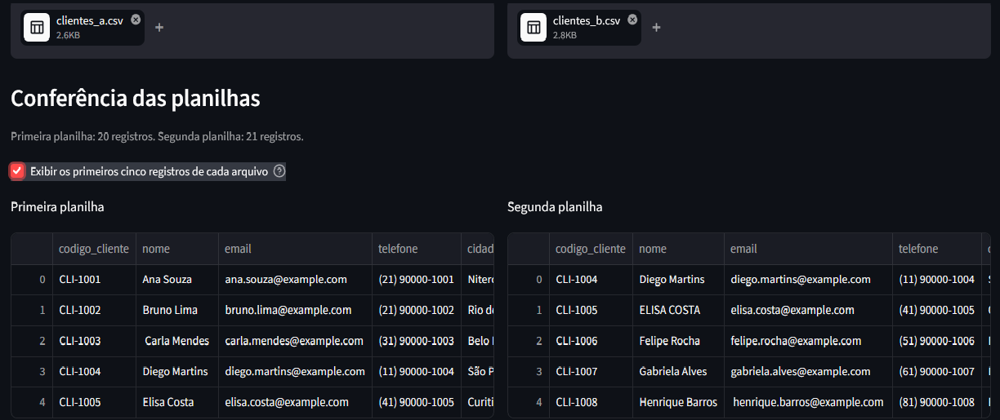
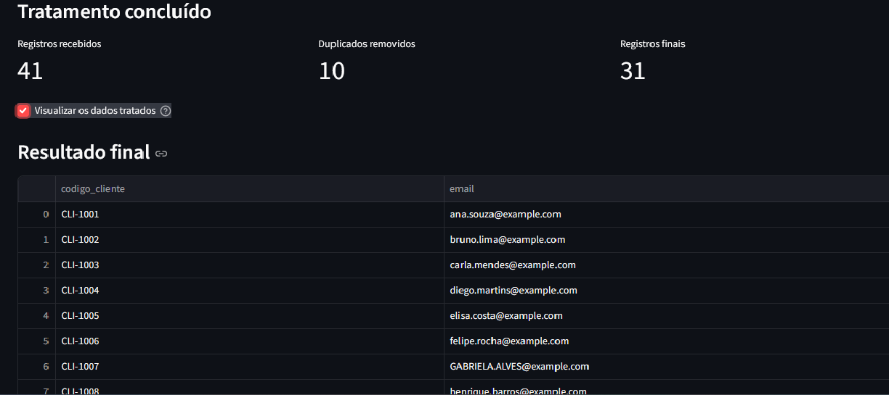
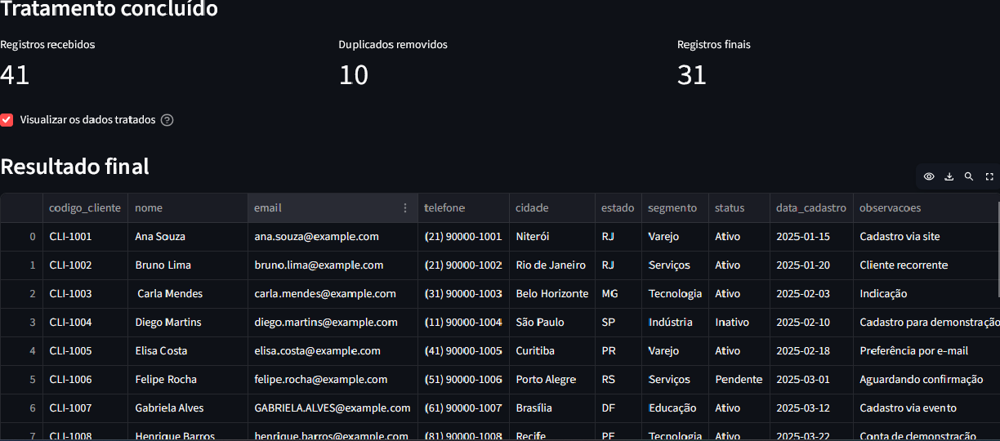

# Planilha Express

### Menos trabalho manual. Mais organização para seus dados.

O Planilha Express é uma ferramenta que combina duas planilhas CSV, identifica registros duplicados e gera um arquivo pronto para download.

A ideia é simples: reduzir tarefas repetitivas e facilitar a organização de dados, sem precisar conferir cada linha manualmente.

## Veja como funciona

### 1. Envie suas planilhas

Selecione os dois arquivos CSV que deseja combinar.

### 2. Escolha como identificar duplicidades

Você pode comparar todas as colunas ou utilizar uma coluna identificadora, conforme a necessidade.

### 3. Baixe o resultado

A ferramenta apresenta um resumo do processamento e permite baixar a planilha tratada.

## O que essa automação pode ajudar a fazer?

- Combinar dados de duas planilhas.
- Identificar e remover registros duplicados.
- Reduzir o trabalho de conferência manual.
- Gerar um novo CSV para continuar seu trabalho.

## Precisa automatizar uma tarefa parecida?

Desenvolvo soluções para simplificar tarefas repetitivas, organizar informações e reduzir processos manuais.

Se você utiliza planilhas no dia a dia e gostaria de automatizar alguma etapa do seu trabalho, entre em contato para conversarmos sobre sua necessidade.

**Tecnologias utilizadas:** Python, Streamlit e pandas.

*Projeto demonstrativo desenvolvido com dados fictícios. A utilização com informações confidenciais exige avaliação específica de segurança e privacidade.*